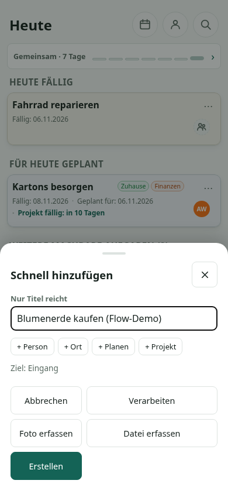

# Before and after: ordinary jobs

These are presentation proposals using existing capabilities. Screenshots are
the current application with synthetic data; text wireframes are proposals.
Source references apply to `53610842`.

## F1: capture without competing with other capture modes

**Observed journey:** open `+`, type a title, Create, optionally Open. This
already succeeds. The enabled Create button is green and recognizable; the
problem is its position and relatively small width, not invisibility.

| Current footer | Proposed footer |
| --- | --- |
| Cancel / Process | **Create, full-width** |
| Photo / File | Cancel / Process |
| Create, alone in the final row | Photo / File |

Same five controls, same three rows, same creation activations. Primary creation
comes before optional processing/material, without an extra disclosure.
Keep existing **Erstellen / Create** and secondary labels.



[Current English desktop capture](images/capture-desktop.png) shows Process
occupying substantially more width than Create.

**Keep:** destination/modifiers, selected material, crop, bounded in-app camera,
native camera/image fallback, general file selection, optional AI processing,
Cancel, submission guards, reset and Open. The photo/file entries in the
accessibility tree are hidden native inputs, not duplicate visible buttons.
Do not delete or conflate them.

**Alternative/no change:** Cancel/Create on the first row is a smaller
rearrangement; retaining the current green-primary layout is also defensible.
Preferred: full-width first Create, without adding rows or hiding other modes.
Check media-first use as carefully as title-first use.

Evidence: `apps/web/src/components/CaptureForm.tsx:544-574`;
`apps/web/src/styles/index.css:2769-2773`;
`apps/web/src/components/QuickAdd.tsx:133-151,195-255`.
Limit the change to Quick Add's presentation, not shared thought/Share behavior.

## F2: a project's main authoring action belongs near its summary

**Observed journey:** captured thought -> convert inactive -> project -> find
Add next step after empty Notes/Outcome -> enter two tasks -> submit -> Close
-> status choice -> start. In this fixture, the driver was already Anna and
the project started directly when ready.

The journey had seven control activations from captured detail, excluding typing
and scrolling. Neither seven nor a source-only missing-driver comparison is a
universal count. No activation decision should be removed to improve that count.

```text
Current:
  Project summary and task count
  Notes
  Outcome
  Tasks: [Add next step] [Structure]

Preferred:
  Project summary and task count: [Add tasks]
  Notes
  Outcome
  Tasks: [Structure]
```

**Move, do not copy, the existing button.** Use **Aufgaben hinzufügen / Add tasks**
to match its existing batch composer. Keep the existing `story.planWork` path,
not a setup wizard or another form.

[Empty-project baseline](images/project-empty-mobile.png): task entry follows
empty supporting sections. [Context-rich counterexample](images/project-context-mobile.png):
dimensions and other constraints should remain prominent before execution.
This counterexample is why universal Notes demotion was rejected.

**Keep:** Notes Edit/Save/Cancel/append, outcome criteria, task outline, Structure,
contextual capture, successor entry, batch drafts, lifecycle guards and explicit
activation. Completed/archived projects must not acquire an authoring button.
Preserve pending locks and the existing return/focus contract.

**Tradeoff:** long-outline users lose the nearby batch button and may need to
return upward or use existing Structure/successor routes. Do not claim every
journey gets shorter or every viewport gains an above-the-fold action.
If accessible placement or long-outline reachability is worse, keep the current
position rather than duplicating controls.

Evidence: `apps/web/src/pages/ProjectDetailPage.tsx:619-746`;
`apps/web/src/components/ProjectTaskEntrySheet.tsx:99-134`.

## F3: make waiting a coherent sequence

### Start a wait where an existing wait is maintained

**Current:** detail -> More options -> Wartet auf -> existing planner.
**Proposed:** detail's planning group -> **Wartet auf / Wait for** -> same planner.

Move the existing eligible missing-wait action out of the general options menu.
Two entry activations become one, from the same starting detail. Assignment is
still separate: choosing an owner does not create an external wait.

Evidence: `apps/web/src/components/TaskDetailSheet.tsx:675,689-705`.
The isolated walkthrough confirmed the options-menu location; difficulty finding
it is an inference, not an observed participant failure.

### Put the next decision before its commit

The current follow-up places outcome and continue/end before Save follow-up,
but its revisit summary/Edit link follows that button. The actual date editor
is farther down, after prerequisites.

```text
Current:
  Outcome
  Continue / end
  Save follow-up
  End without response; revisit summary / Edit
  Prerequisites
  Existing date editor

Minimum proposed:
  Outcome
  Continue / end
  Existing revisit summary / Edit
  Save follow-up
  Separate end-without-response route
  Prerequisites; existing date editor
```

[Current follow-up viewport](images/followup-mobile.png) and
[separate date-editor viewport](images/followup-date-mobile.png).

**Be precise about the benefit:** the minimum change improves decision order.
It does not eliminate the distance to the date editor or save a disclosure tap.
Keep one editor, draft and existing disclosure. Do not add a contextual planner
mode or auto-expand/collapse it on continue/end selection.

**Observed success:** outcome + changed revisit + Save follow-up closed Planning
and returned to Waiting with the attributed note and new revisit. There are
**not two mandatory saves**. Keep this existing atomic follow-up operation.
General planning Save and end-without-outcome remain distinct supported actions.
Ending an external wait must not clear prerequisites.

**Alternative:** fully adjacent date editing could be explored later, but only
with the same editor/draft and no extra modes. No change is preferable to a
second date editor or ambiguous save ownership.

Evidence: `apps/web/src/components/TaskPlanningSheet.tsx:710-750,1180-1248,1265-1393`.

## F4: write known steps without finding a structural submenu

**Current:** captured detail -> Actions -> Structure -> Split -> write steps.
**Proposed:** captured detail -> secondary **Teilaufgaben hinzufügen / Add subtasks**
-> the same composer -> submit.

Composer entry changes from three activations to one; submission and legitimate
conversion/activation decisions do not disappear. The shortcut adds one visible
control, justified by removing two intervening surfaces for an existing intent.

```text
Existing classifications, retained:
  Ready action | Convert to project | Someday

Secondary authoring shortcut:
  Add subtasks
```

[Current captured detail](images/clarification-mobile.png) already fits the
classification choices in this short mobile example. Moving classification
upward alone is therefore not the principal recommendation.

**Keep:** task-with-children, explicit optional Treat as project/default-off,
direct project conversion, Ready, Someday, ordinary planning, Structure and
reviewed AI. The first child batch already classifies the captured parent
atomically. Use `task.split`, `TaskSplitSheet` and `StepComposer`; do not
introduce a chooser, wizard or automatic project treatment.

Use **Add subtasks** for task children and **Add tasks** for project batch entry.
Place existing manual authoring before optional AI within Structure, retaining
AI visibly at the same depth. Do not make four equal primary buttons.

**Alternative/no change:** consistent naming/manual-first Structure alone adds
no shortcut control, but leaves the three-activation entry. Preserve pending
and unsaved-content safety for a new direct launcher; return focus to that
launcher when the existing workflow closes.

Evidence: `apps/web/src/components/TaskDetailSheet.tsx:738-764,902-912`;
`apps/web/src/components/TaskStructureSheet.tsx:19-56`;
`apps/web/src/components/TaskSplitSheet.tsx:121-204`.

## F5: Review should emphasize the decision its reason asks for

Routine `review_task`/`review_project` suggestions can resolve to the same detail
inspection as the generic Details button. This is source-supported; the sampled
runtime Review contained repairs and completion, not the routine duplicate.

```text
Routine self-review:
  Reason -> explicit Keep -> one Details -> existing change decisions

Repair:
  Reason -> specific repair -> Details -> existing lifecycle decisions

Completion:
  Preserve the existing guarded completion decision
```

[Desktop repair baseline](images/review-desktop.png) shows why a real repair
must remain distinct from Details.

**Removal rule:** consider only `review_task` / `review_project` with the item
itself as resolved target, and prove identical intent, focus and return behavior.
Otherwise retain both. "Routine" or equal labels alone are not sufficient;
backlog revisit's `defer_project` is not in this whitelist.

Keep all lifecycle choices, explicit acknowledgement, issue return and focus.
Opening details never acknowledges. Keep must not become the universal primary
action on structural defects.

Evidence: `apps/web/src/pages/ReviewPage.tsx:236-335,538-557`;
`apps/api/src/domain/reviewItems.ts:350-408`.
